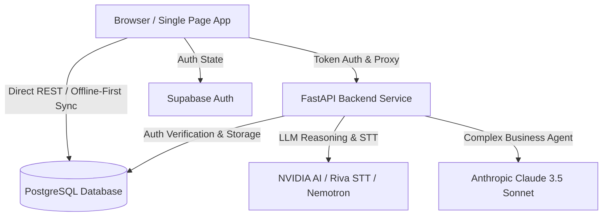
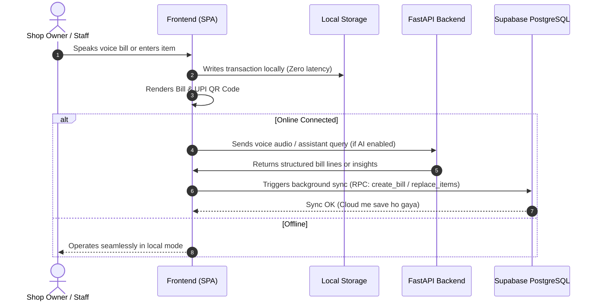
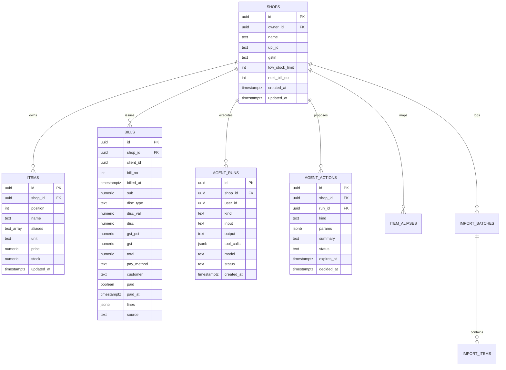

# BOLL BILL (बोल बिल) - Intelligent Multilingual Voice & AI Billing System

> Fast, offline-first voice billing system and business assistant tailored for Indian retail, wholesale, and kirana stores.

---

## 🌟 Key Features

- **Multilingual Voice-to-Bill**: Support for Hindi, Hinglish, and English voice commands via Web Speech API and NVIDIA Riva Cloud STT fallback.
- **AI Business Assistant & Reasoning**: Powered by NVIDIA Nemotron & Claude 3.5 Sonnet to query sales, stock, pending udhaar, and execute safe business tools.
- **Offline-First Data Sync**: Instant local updates with automatic bi-directional sync to Supabase PostgreSQL when connected.
- **GST & UPI Billing**: Full GST calculation (CGST/SGST/IGST), discount options (% or flat ₹), and automatic dynamic UPI QR generation.
- **Udhaar Management**: Debt tracking, overdue reminders, and WhatsApp customer messaging directly from the interface.
- **Purchase CSV/TSV Import**: Auto-detection of columns, alias matching, price margin computation, and multi-step preview/commit with undo.
- **Enterprise-Grade CI/CD & Deploy**: Native GitHub Actions automated testing suite and unified Vercel deployment configuration.

---

## 🏗 System Architecture

BOLL BILL uses an offline-first single-page frontend (HTML5/CSS3/Vanilla JS) connected to a high-performance FastAPI asynchronous backend, backed by Supabase PostgreSQL with Row Level Security (RLS).



### Request & Sync Lifecycle



---

## 📊 Database Architecture

The PostgreSQL schema enforces strict data integrity, isolation per shop, and secure Row Level Security (RLS) policies.

### Entity-Relationship Diagram



---

## 📁 Project Structure

```
d:/bollbill/
├── .github/
│   └── workflows/
│       └── ci-cd.yml             # GitHub Actions CI/CD Pipeline
├── backend/
│   ├── app/
│   │   ├── agent.py              # LLM agent coordinator & prompts
│   │   ├── analytics.py          # Business stats & sales calculations
│   │   ├── auth.py               # Supabase token validation & cache
│   │   ├── config.py             # App environment variables & settings
│   │   ├── db.py                 # Async HTTP database interface
│   │   ├── errors.py             # Custom domain error hierarchies
│   │   ├── importer.py           # Purchase file parsing & column detection
│   │   ├── main.py               # FastAPI application & API endpoints
│   │   ├── reasoning.py          # NVIDIA Nemotron client & chain logic
│   │   ├── stt.py                # Speech-to-text integration (NVIDIA Riva)
│   │   ├── tools.py              # Tool execution (stock, bills, udhaar)
│   │   └── udhaar_agent.py       # Udhaar reminder generation & inbox
│   ├── tests/
│   │   ├── test_backend.py       # Unit tests for core business calculations
│   │   └── test_release2.py      # Tests for file import and udhaar agent
│   └── requirements.txt          # Python dependencies
├── frontend/
│   ├── index.html                # Single Page Application (UI + Engine)
│   └── tests/
│       └── sync_harness.js       # Offline & bi-directional sync unit tests
├── supabase/
│   └── schema.sql                # Complete PostgreSQL schema & RLS rules
├── requirements.txt              # Root build requirements for Vercel
├── vercel.json                   # Unified full-stack deployment config
└── README.md                     # Comprehensive project documentation
```

---

## 🚀 Getting Started

### Prerequisites

- **Python 3.10+** (Tested on Python 3.11 / 3.12 / 3.14)
- **Node.js 18+** (For running frontend synchronization unit tests)
- **Supabase Account** (For cloud database and authentication)

### 1. Clone the Repository

```bash
git clone https://github.com/Ayushpatel0329/bollbill.git
cd bollbill
```

### 2. Configure Environment Variables

Create a `.env` file in the `backend/` directory:

```ini
# Supabase Configuration
SUPABASE_URL=https://your-project.supabase.co
SUPABASE_ANON_KEY=your-supabase-anon-key

# AI Provider Keys
NVIDIA_MAIN_API_KEY=nvapi-your-key-here
NVIDIA_MAIN_MODEL=nvidia/nemotron-3.5-super-vl-120b-a12b
NVIDIA_BASE_URL=https://integrate.api.nvidia.com/v1
NVIDIA_STT_API_KEY=nvapi-your-key-here

# Optional: Claude / Anthropic
ANTHROPIC_API_KEY=sk-ant-your-key-here

# System Settings
ALLOWED_ORIGINS=*
RATE_LIMIT_PER_MIN=60
DAILY_AI_LIMIT=500
MAX_TOOL_ROUNDS=5
SHOP_TIMEZONE=Asia/Kolkata
```

### 3. Setup Database Schema

1. Open your Supabase Project Dashboard.
2. Navigate to **SQL Editor** -> **New query**.
3. Copy and run the entire content of [`supabase/schema.sql`](supabase/schema.sql).

### 4. Run Backend Server

```bash
cd backend
pip install -r requirements.txt
python -m uvicorn app.main:app --host 127.0.0.1 --port 8000 --reload
```

The backend API will be available at `http://127.0.0.1:8000`. You can inspect documentation at `http://127.0.0.1:8000/docs`.

### 5. Run Frontend

In a separate terminal:

```bash
python -m http.server 5500 --directory frontend
```

Open `http://127.0.0.1:5500` in your web browser.

---

## 🧪 Testing Suite

### 1. Core Backend Business Logic Tests
```bash
cd backend
python -m tests.test_backend
```
*Validates tax/discount formulas, chat cleaning, safety guards, and tool outputs (14 tests).*

### 2. Purchase Import & Udhaar Agent Tests
```bash
cd backend
python -m unittest tests/test_release2.py
```
*Validates CSV column parsing, fuzzy item matching, margin computation, and overdue bill discovery (8 tests).*

### 3. Frontend Bi-Directional Cloud Sync Harness
```bash
node frontend/tests/sync_harness.js
```
*Executes simulated browser offline mutations, cloud conflict resolution, clashing bill numbers, and isolated multi-tenant clean states (18 tests).*

---

## 🚢 Deployment

### Vercel Unified Deployment

The repository includes a root `vercel.json` and `requirements.txt` to deploy both frontend static assets and backend serverless endpoints on Vercel:

1. Import your GitHub repository into Vercel.
2. Add the environment variables (`SUPABASE_URL`, `SUPABASE_ANON_KEY`, `NVIDIA_MAIN_API_KEY`, etc.) in Project Settings.
3. Deploy!
   - `/api/*`, `/agent/*`, `/health`, `/docs` route directly to `@vercel/python` backend.
   - All other routes serve the static frontend.
