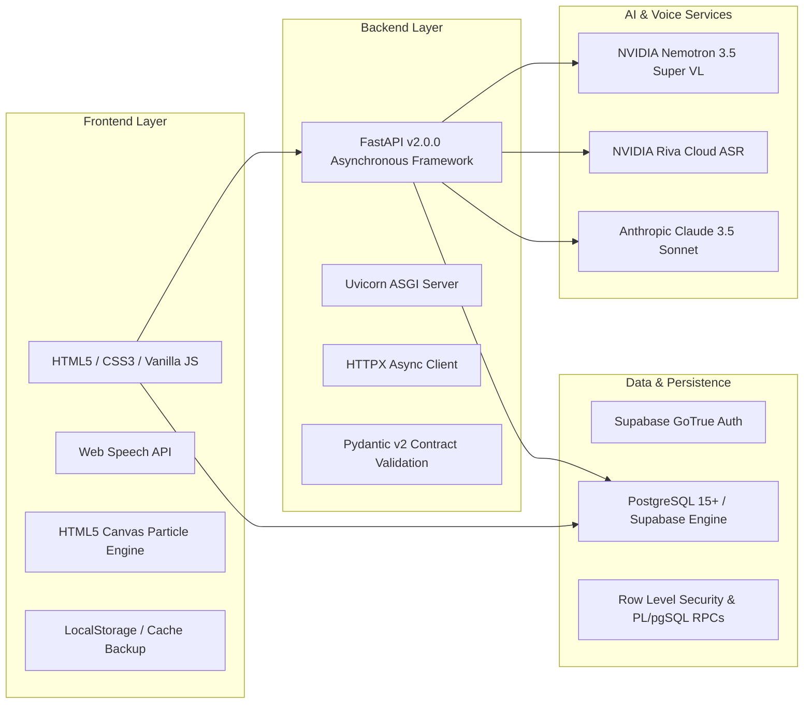

# BOLL BILL (बोल बिल) - Technology Stack & Model Specifications

This document provides an exhaustive breakdown of the technical stack, architectural roles, releases, specific API models, and third-party dependencies used across the BOLL BILL system.

---

## 📑 Overview of Tech Stack Layers

---

## 🧠 AI Models & Cloud Cognitive Services

| Service / Capability | Provider | Model / Endpoint Identifier | Version / Release | Primary Purpose & Usage |
| :--- | :--- | :--- | :--- | :--- |
| **Primary Voice Bill & Chat Reasoning** | NVIDIA Cloud API | `nvidia/nemotron-3.5-super-vl-120b-a12b` | Release 2.0 | High-reasoning model handling bilingual voice dictations (Hindi/Hinglish/English), mapping natural speech to items, quantities, and prices, and calculating discounts/GST. |
| **Speech-to-Text (STT) Fallback** | NVIDIA Cloud Functions | NVIDIA Riva Conformer-CTC ASR | Production API | Processes binary audio recordings uploaded from devices without browser-level Web Speech support or noisy environments. |
| **Complex Business Agent & Tool Calls** | Anthropic | `claude-3-5-sonnet-20241022` | API v1 | Deep multi-turn agent execution for executing shop actions (settling udhaar, finding overdue accounts, inventory analysis). |
| **Native Audio Dictation** | Client Browser Engine | W3C Web Speech API (`webkitSpeechRecognition`) | Living Standard | Instant zero-latency speech recognition directly on client devices in Indian locales (`en-IN`, `hi-IN`). |

---

## ⚙️ Backend Technology Stack

### Runtime & Framework
- **Language**: Python 3.10+ / 3.11 / 3.14 compatible
- **Web Framework**: `FastAPI` (>=0.115.0)
  - Purpose: High-speed asynchronous REST API endpoints with auto-generated OpenAPI/Swagger specifications.
- **ASGI Server**: `Uvicorn` with standard extras (>=0.34.0)
  - Purpose: Production lightning-fast ASGI server handling concurrent async HTTP requests.

### Libraries & Dependencies
- **`httpx` (>=0.28.0)**: Fully asynchronous HTTP client used for non-blocking communication with Supabase REST endpoints, NVIDIA API, and Anthropic API.
- **`pydantic` (>=2.7.0)**: Strict typing and data validation for API payloads (import rows, bill structures, authentication requests).
- **`python-multipart` (>=0.0.9)**: Streaming multi-part form data parser for purchase CSV/TSV file imports and audio binary uploads.
- **`anthropic` (>=0.40.0)**: Official Anthropic Python SDK client for tool-use agentic workflows.
- **`openai` (>=1.50.0)**: Official OpenAI Python SDK client configured to communicate with the NVIDIA OpenAI-compatible API base URL (`https://integrate.api.nvidia.com/v1`).
- **`tzdata` (>=2024.1)**: Timezone database supporting strict local store timezone enforcement (`Asia/Kolkata`).

---

## 🎨 Frontend Technology Stack

### Architecture
- **Frameworkless Architecture**: Native Vanilla JavaScript (ES2022+), CSS3 Variables, and HTML5.
- **Zero Build Step**: Runs directly in any modern browser without bundlers (Webpack, Vite, Rollup), allowing instant deployment and offline loading.

### Client-Side Engines
- **Supabase JS Client (`@supabase/supabase-js`)**: Version 2.x loaded via CDN for real-time Postgres synchronization, authentication token storage, and database access.
- **Dynamic UPI QR Code Generator (`qrcode.js`)**: Real-time rendering of NPCI-compliant UPI payment QR codes (`upi://pay?pa=...&am=...`).
- **Canvas Particle Typography**: Lightweight canvas particle simulation powering the minimal hero section matching fintech aesthetic standards.
- **Offline Sync & Storage Engine**: Custom dual-engine state manager with SHA-256 local credential hashing, optimistic local updates, and conflict-resolving bi-directional cloud synchronization.

---

## 🗄 Database & Infrastructure

### Database Engine
- **Engine**: PostgreSQL 15+ (Hosted on Supabase)
- **Extensions**:
  - `pgcrypto` (`gen_random_uuid()`, cryptographic operations)
  - `plpgsql` (Stored procedures for atomic multi-table updates)

### Key Database RPC Functions
- `public.save_shop(p_name, p_upi, p_gstin, p_low_stock)`: Atomic upsert of shop profile with RLS validation.
- `public.replace_items(p_items)`: Full atomic synchronization of catalog items and stock levels.
- `public.create_bill(...)`: Transactional bill generation with client idempotency check (`client_id`).
- `public.mark_bill_paid(p_bill_no)`: Udhaar ledger settlement.
- `public.undo_import_batch(p_batch_id)`: Reverses imported inventory stock changes atomically.

---

## 🚀 CI/CD & Deployment Stack

- **Vercel Serverless Architecture**:
  - Frontend: `@vercel/static` for CDN-distributed caching and instant global asset delivery.
  - Backend: `@vercel/python` serverless runtime executing FastAPI routes at `/api/*` and `/agent/*`.
- **GitHub Actions (`.github/workflows/ci-cd.yml`)**:
  - Matrix Runner: `ubuntu-latest`
  - Automated Stages:
    1. Python unit tests (14 core business calculations)
    2. Python release tests (8 import & udhaar tests)
    3. Node.js headless sync harness (18 bi-directional sync tests)
    4. Vercel deployment configuration integrity check
